

  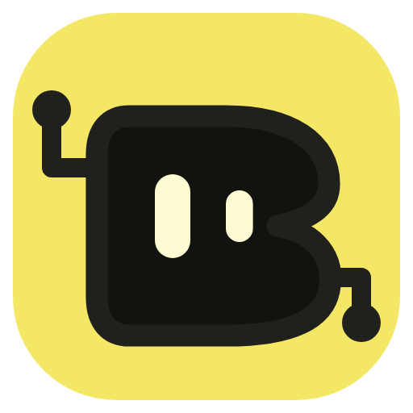
  <h1>Behave</h1>
  
<strong>The new way to write code.</strong>

  
The AI coding IDE for engineers.

  
<a href="#see-it-on-a-real-system">See it on a real system</a>

 

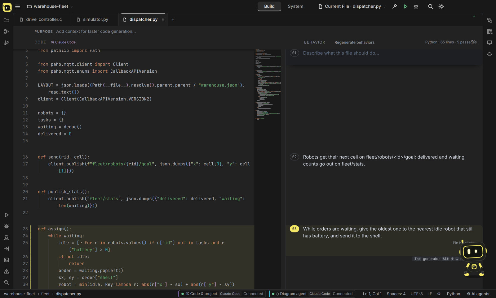

## Is AI going to take over coding?

That's what a lot of people are saying: soon AI writes all the code, and programmers aren't needed anymore.

We see AI as another step in how programming tools evolve. Compilers saved us from
writing machine code by hand. High-level languages let us write for people instead of processors. Now AI takes care of
much of the syntax. Every time, engineers didn't disappear. They moved up a level and built bigger systems.

## The problem is the workflow

What hasn't caught up is how engineers and AI work together. Today it happens in a chat: you explain what you want,
wait, and read through whatever comes back. The intent stays buried in the chat history. Changes land across files and
nobody can say why. Nothing in the project ties a piece of code to what it was meant to do, so every change starts with
explaining the project all over again.

## Behave is that workflow

In Behave you write **behaviors**: plain sentences that say what the code should do, right beside the code. Press
**Tab** and your AI writes the code for that sentence, in place. Behavior and code stay tied together: change one, and
Behave keeps the other in step. Zoom out, and the same project is a system map read from the code itself.

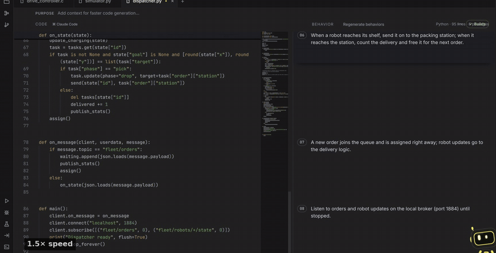

*Three behaviors written one after another; each Tab starts while the next sentence is being typed. Live, with Claude
Code on Sonnet (shown at 1.5× speed). [Full-quality video](docs/images/readme/tab-clip.mp4)*

## See it on a real system

Everything below is the same project, with Claude Code (Sonnet) as the AI agent. The project is a
**warehouse robot fleet**: six robots carry shelves to packing stations.

| Part | Language | What it does |
| --- | --- | --- |
| Drive firmware | C | Wheel speed control, emergency stop when something is too close |
| Digital twin | Python | Simulates the warehouse and runs the **real firmware** for every robot |
| MQTT broker | Mosquitto in Docker | Carries every message between the parts |
| Dispatcher and order feed | Python | Sends the nearest idle robot to the shelf, then to the packing station |
| Dashboard | Node.js | A live map of the warehouse in the browser |

### 1. Write what it should do. Press Tab.

Robots were running their batteries flat. So we wrote one sentence under the dispatcher's assignment logic:

> *Robots below 20 % battery go to the nearest free charger and get no new orders until they are back above 90 %.*

and pressed **Tab**. Claude Code wrote the charging logic beside the sentence and, because "Allow changes to other code"
was on, also changed `assign()` so robots that are charging get no new orders. That passage keeps its own code, and its
sentence was updated to say so.
You can keep writing the next behavior while code streams in, and the whole change is one Undo.

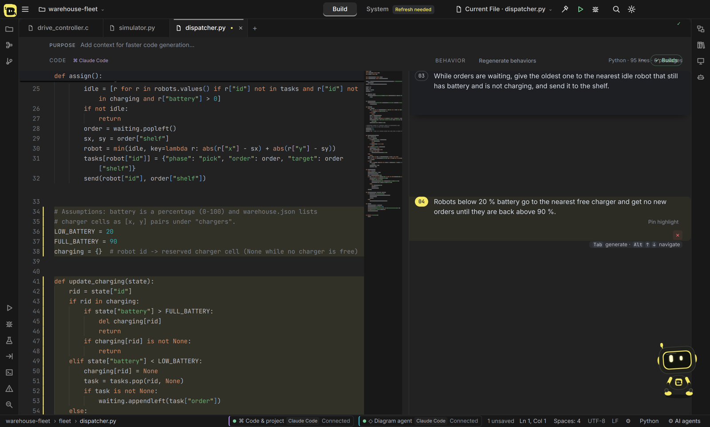

### 2. A second AI reviews what was just written

After every generation, a separate review agent reads **only the changed lines** and reports concrete risks: a crash,
a hang, a leak, a side effect nobody asked for. Each finding names the line and the scenario, under the behavior it
belongs to, with **Fix** or **Dismiss**, one at a time. Here it caught a real bug in the new charging code: a robot that
goes low while already carrying an order puts that order back in the queue, so it gets delivered twice. It can be wrong,
so you decide.

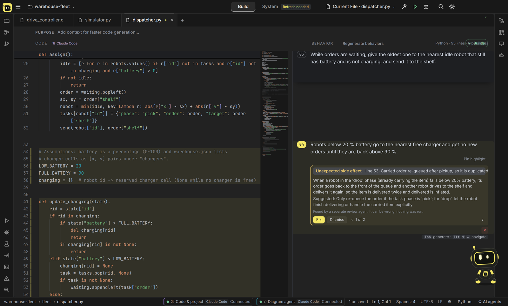

### 3. Change the code, and the behavior follows

Edit the code by hand and the sentence corrects itself. Here the obstacle stop in the C firmware went from 0.5 m to
0.8 m, and the behavior now says 0.8 m. Simple edits are matched without any AI call; only real rewrites ask the
agent, and if you wrote the sentence yourself and it conflicts, your text wins.

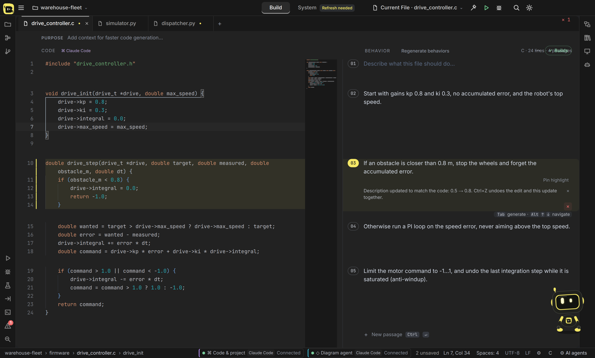

### 4. Existing code? Behave explains it

Open a file nobody described and Behave writes its purpose and behaviors, streamed in beside the code, down to the
branches of one request handler. Here, the dashboard server written in JavaScript.

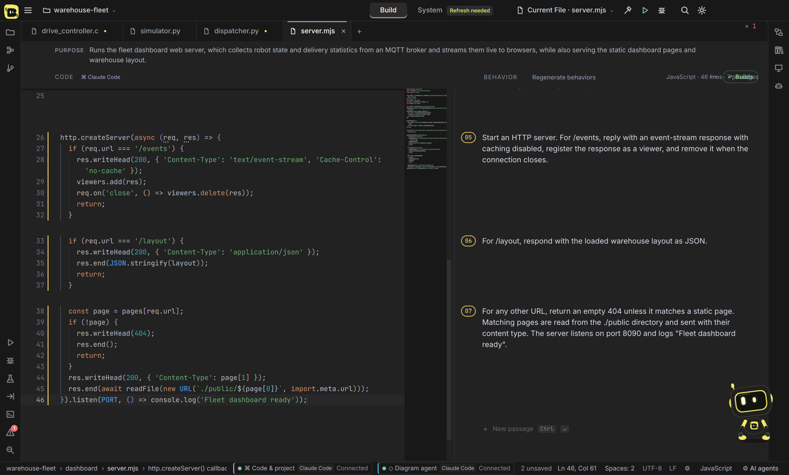

### 5. The architecture, read from the code

The System view is built from the source, not drawn by hand: the twin, the broker, the dispatcher, the order feed
and the dashboard, connected by the MQTT topics they really use. Every box and arrow points back to the code it came
from, and anything Behave could not establish is listed instead of guessed.

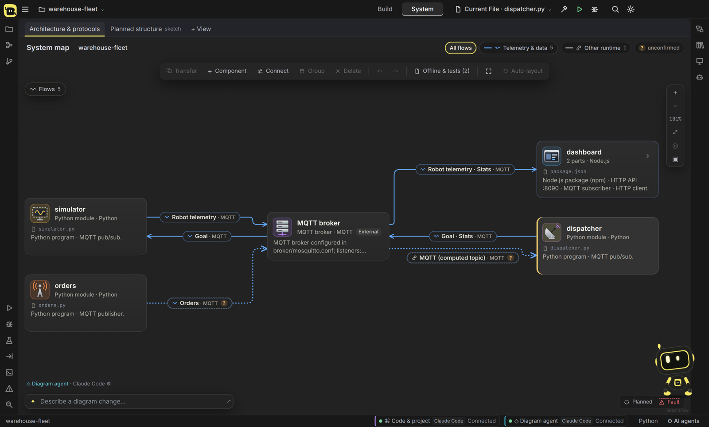

### 6. …and where it's going

Point Behave at a README, a spec or a PDF and the agent sketches the **planned** structure in one call, with each
connection labelled by its type (MQTT, REST, CAN…): here the lidar safety node, the WMS connector, the traffic
manager and fleet analytics that the README promises but the code doesn't have yet.

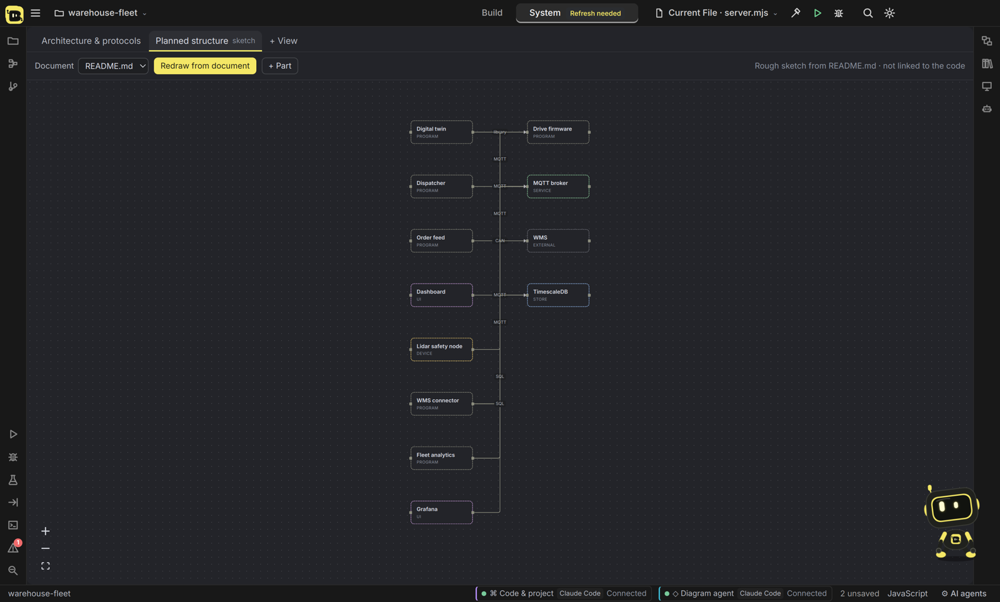

### 7. Run the whole system from the same place

**Systems › Setup** lists everything this project needs to run, found on its own: the firmware build, Mosquitto
**in Docker** (from `docker-compose.yml`), the twin, the dispatcher, the order feed and the dashboard, each with how
Behave knows it is ready. Each part says where it runs: this computer, a Docker container, or a VM you added.

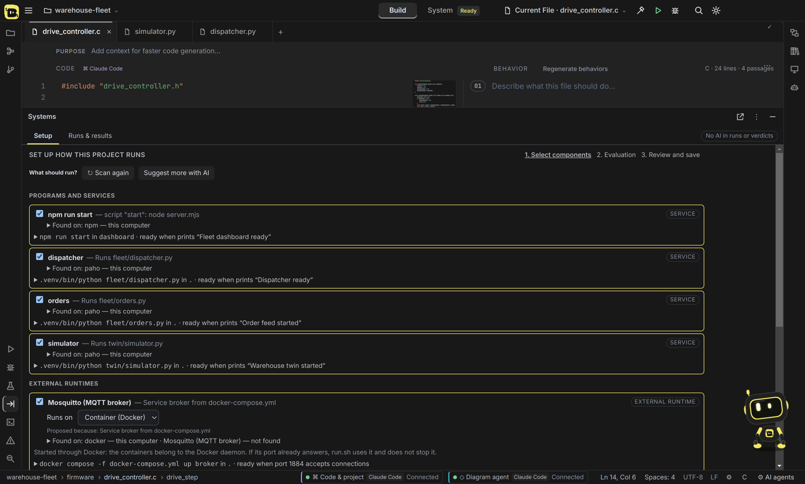

Tick the parts and Behave writes an ordinary `run.sh` you can read and keep. **Run system** builds first, starts each
part in order and waits until each one is ready.

While the system runs, the dashboard, dispatcher, order feed and simulator each have their own **interactive terminal**.
Switch between their tabs to see output and type directly into that component's process. Ctrl+C interrupts the selected
component; **Open in Terminal** opens the same session in the Terminal tool window. Logs stay available separately.
**Stop system** stops only what the run started, Docker containers included.

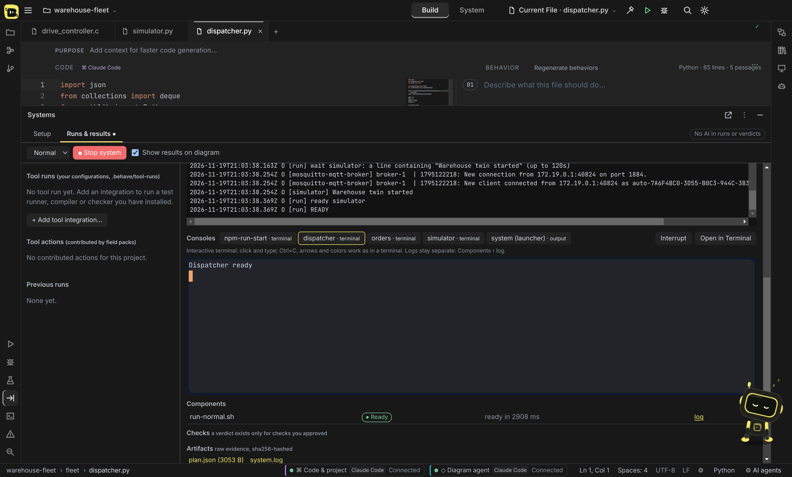

And the warehouse, running the code from above. Robot 3 is low (red) and heads to a charger instead of taking orders:

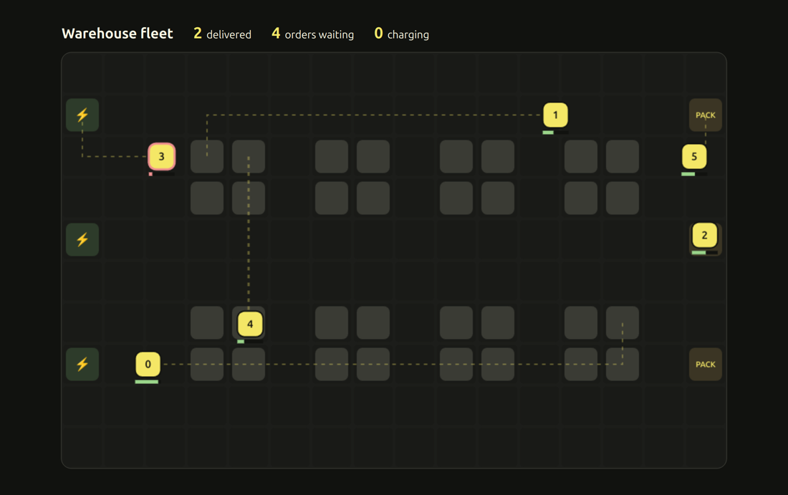

### 8. A library of engineering knowledge

Behave knows what kind of system you're building. Its library covers ten engineering fields (software and web,
embedded Linux, microcontrollers, native builds and bare metal, electronics and HDL, robotics and control, industrial
automation, networking, data and AI, simulation and digital twins) with components, toolchains and proven patterns.
Open a project and the library says which fields it looks like and why, which of its components your code already
uses (down to `file:line`), and which tools the project relies on. Start a new project from a field and a short
description, and Behave drafts the starting folder and its diagram. Teams can add their own packs.

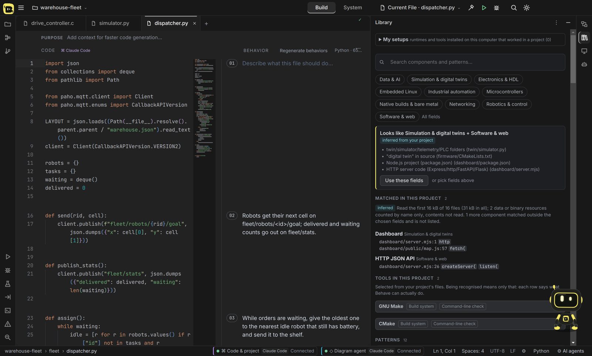

## Open a folder. Behave does the rest.

You don't configure anything first. Point Behave at an existing project folder and it works out the rest on its own:

- **What the project is.** It finds the main programs and what each one does, from the code, not from file names.
- **The behaviors.** One click writes behaviors beside the code of every main file, so you can read any of them
  in plain sentences.
- **The architecture.** It reads the system map from the source: the programs, the broker, the topics and ports
  between them.
- **The engineering field.** The library recognises what kind of system it is and matches its components to your code.
- **How to run it.** It finds what has to start (builds, brokers in Docker, services, simulators) and how to tell when
  each one is ready, then writes a `run.sh` you can read.

Here is the warehouse fleet shown above, opened with no Behave data at all:

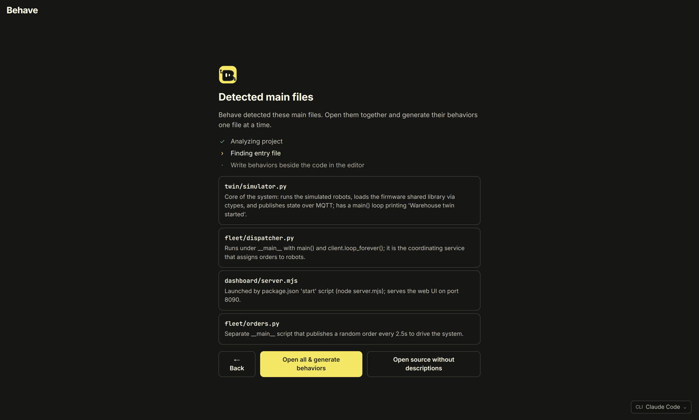

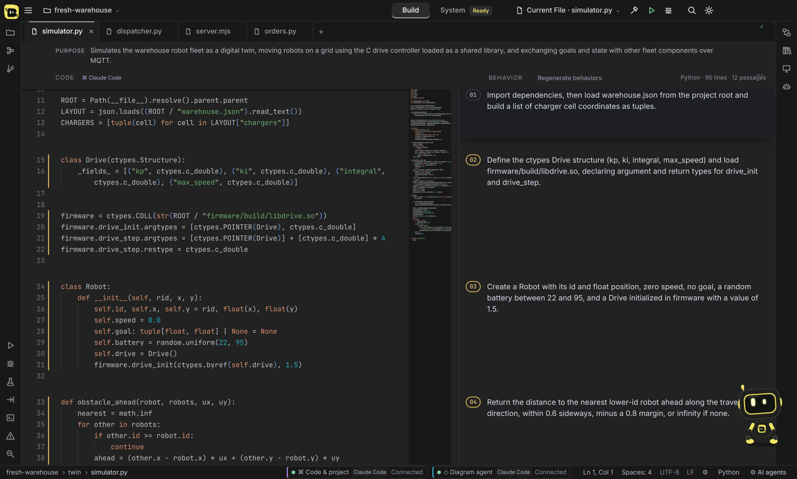

## Built for engineering systems, not just files

- **Your own AI.** Claude Code or Codex, on your own subscription and sign-in. One agent for code, one for diagrams;
  they can be the same. Each file keeps a warm AI session, so a change sends what changed, not the whole project
  again.
- **Many languages, one workflow.** Python, C and C++, Rust, JavaScript and TypeScript, with real compiler and
  language-server diagnostics from your own toolchain.
- **Your project stays a project.** Ordinary source files that open in any editor and build with their normal tools.
  Behaviors, mappings and diagrams live in one `.bhv` project document next to them.

## Status

Behave is an **experimental preview**. It is developed and tested on Linux x64; macOS and Windows packages can be
built but have not been validated on those machines. Generated code is only as good as the agent behind it, and a
review finding is advice, not proof.

This repository is a public showcase. The application source repository is private.

Built with React, TypeScript, Monaco, React Flow, Node.js and Electron.

## License

No open-source license has been selected yet. Do not assume permission to redistribute the application. Third-party
dependencies keep their own licenses.
